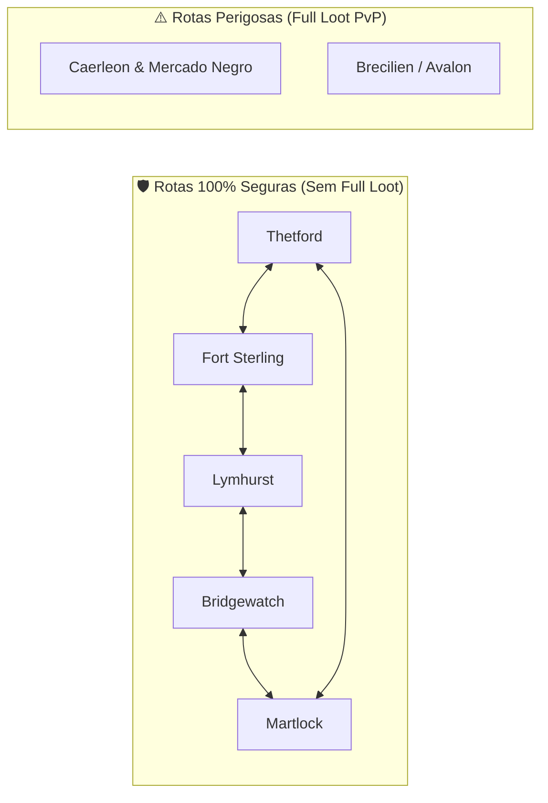
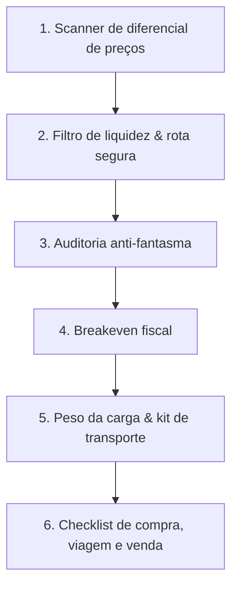

# 🚚 Albion Online — Co-piloto de Arbitragem & Transporte Intercidades

Transforma o agente em **Operador Logístico e Especialista em Arbitragem Intercidades**.

O objetivo é lucrar com o diferencial de preços entre praças, priorizando rotas sem risco de perda de carga (Continente Real) e rotas de alta margem protegidas por travas fiscais e anti-fantasma.

---

## 🗺️ Classificação de Rotas por Perfil de Risco



| Categoria | Cidades | Risco de Perda | Montaria Recomendada |
| :--- | :--- | :--- | :--- |
| **100% Segura** | Thetford, Fort Sterling, Lymhurst, Martlock, Bridgewatch | **Zero risco de capital** (*knockdown*, sem perda de itens) | Boi T5 a T8 / Mamute de Transporte |
| **Zona Vermelha** | Caerleon / Mercado Negro | **Perda total (Full Loot)** se abatido | Cavalo Blindado / Garra-ligeira / Salamandra |

---

## 🛡️ Salvaguardas Anti-Alucinação & Regras Fiscais

1. **Trava Anti-Ordem Fantasma:** se o menor sell order no destino estiver **> 45%** acima da média histórica de 7 dias, **nunca** projete receita pelo preço listado. Aplique o teto de **+15%** sobre a média.
2. **Breakeven exato:**
   $$\text{Custo Efetivo} = \text{Preço Compra} \times 1{,}025 \text{ (se Buy Order)}$$
   $$\text{Preço Mínimo de Venda} = \frac{\text{Custo Efetivo}}{1 - \text{Taxa} - 0{,}025}$$
   *(Taxa = 4% com Premium ou 8% sem Premium)*
3. **Portão de liquidez:** exija **≥ 1,0 venda/dia**. Abaixo disso, o capital fica preso.
4. **Dimensionamento de carga:**
   $$\text{Capacidade} = (\text{Montaria} + \text{Bolsa} + 50) \times (1 + \text{Torta}\%) \times (1 + \text{Bota}\%)$$
   Nunca passe de 100% da capacidade (penalidade de marcha lenta).

---

## 🔄 Fluxo de Trabalho



---

## 🛠️ Comandos

```bash
# 1. Escanear arbitragem (rotas seguras, Premium ativo)
python3 .opencode/skills/albion-arbitrage-copilot/scripts/scan_arbitrage.py \
  --origin Thetford --destination Martlock --premium --min-roi 15 --safe-only

# 2. Universo amplo, incluindo Black Market
python3 .opencode/skills/albion-arbitrage-copilot/scripts/scan_arbitrage.py \
  --premium --min-roi 20

# 3. Auditar uma cotação suspeita (média histórica 7d + teto de bid)
python3 .opencode/skills/albion-investment-wizard/scripts/live_market_audit.py \
  --city Martlock --items T4_BAG

# 4. Breakeven e peso de carga (via núcleo compartilhado)
python3 - <<'EOF'
import sys; sys.path.insert(0, ".opencode/skills")
from _albion_core import anti_phantom
print(anti_phantom.calculate_breakeven_price(buy_price=4000, has_premium=True))
print(anti_phantom.calculate_exact_loadout_capacity(
    [{"item_id": "T5_METALBAR", "weight_unit_kg": 0.9, "quantity": 1500}],
    mount_id="OX_T5", bag_id="T5.0", pie_id="T7_PORK"))
EOF
```

O scanner já devolve `roi_pct`, `unit_profit` e `is_safe_route` por oportunidade — use esses campos em vez de recalcular.

---

## ❤️ Transporte de Facção (Corações)

O transporte de facção é a outra face da logística: entrega no **Contrabandista** (mapa aberto) e retorno obrigatório à cidade natal. **O jogador nunca entra em Caerleon nem na capital de destino.**

```bash
# Fardo médio (7 corações), rota segura, Premium
python3 .opencode/skills/albion-arbitrage-copilot/scripts/calculate_hearts.py \
  --city Lymhurst --silver 1000000 --mount T5_BOAR --risk SAFE_ONLY --pack 7 --premium

# Permitindo Caerleon (Zona Vermelha / Full Loot)
python3 .opencode/skills/albion-arbitrage-copilot/scripts/calculate_hearts.py \
  --city Lymhurst --silver 5000000 --mount T6_OX --risk ALLOW_RED_ZONE --pack 15 --premium

# Sobrescrever cotações (quando o jogador informa os preços do jogo)
python3 .opencode/skills/albion-arbitrage-copilot/scripts/calculate_hearts.py \
  --city Lymhurst --silver 1000000 --pack 7 --premium \
  --origin-heart-price 34000 --shadowheart-price 46500 --cape-price 65000
```

A saída traz: ranking de estratégias (venda paciente, loop de recompra, venda direta, manufatura de capas), financeiro por viagem e prata/hora, protocolo operacional, `price_statement_markdown` e `cape_investment_markdown`.

> [!IMPORTANT]
> **Transmutação:** o NPC municipal só converte **Corações Sombrios** (Caerleon) em corações da cidade natal (+5.780 🪙). **Não existe transmutação entre capitais reais** — corações de outra capital só servem para capas daquela cidade (ex: Fort Sterling / Morta-Viva) ou venda no mercado local.

---

## 📋 Como responder ao jogador

1. Liste as oportunidades em tabela: **item, cidade de compra, preço, cidade de venda, preço, lucro/unidade, ROI**.
2. Marque 🛡️ rotas seguras e ⚠️ rotas com Zona Vermelha.
3. Para a melhor oportunidade, rode a auditoria anti-fantasma e informe `phantom_audit.status` e o teto de bid.
4. Feche com o kit de carga (montaria/bolsa/torta) e o número de viagens necessárias para o capital do jogador.
5. **Nunca invente preços.** Se a API não retornar cotação, diga que não há ordem ativa e peça ao jogador para abrir o mercado no jogo.
