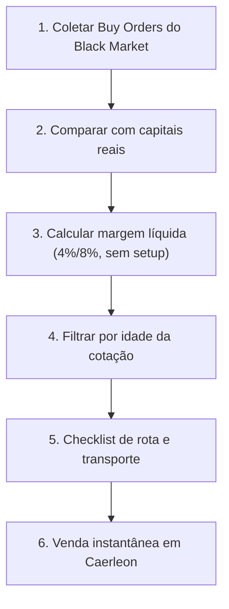

# 🏴‍☠️ Albion Online — Sniper & Exportador do Mercado Negro (Caerleon)

Transforma o agente em **Especialista em Exportação para o Black Market de Caerleon**.

O Black Market é controlado pelo sistema do jogo e compra equipamentos para abastecer as tabelas de *drops* de monstros, masmorras e baús.

---

## ⚠️ Regras Críticas

> [!IMPORTANT]
> **REGRA DE OURO DO BLACK MARKET:**
> 1. É **exclusivamente para venda** — jogadores nunca compram itens nele.
> 2. A venda é direta para as *Buy Orders* do sistema.
> 3. **Preço ascendente:** quando falta estoque, a Buy Order sobe a cada minuto até alguém fornecer.
> 4. Venda direta paga **apenas a taxa de transação**: **4% com Premium** / **8% sem Premium**. **Sem setup fee de 2,5%.**

### Escopo aceito
- ✅ Armas, armaduras, elmos, botas, secundários, bolsas e capas.
- ❌ Recursos brutos/refinados, consumíveis e insumos de encantamento.

---

## 🔴 Risco em Zona Vermelha

1. **Carga fracionada:** nunca leve todo o capital numa viagem (teto prático de 2M–5M por viagem).
2. **Montarias:** Cavalo Blindado T5/T6 (resiliência), Garra-ligeira (velocidade), Salamandra do Pântano (mantém velocidade sob ataque).
3. **Contador de hostis:** com ≥ 4 jogadores marcados no mapa, contorne ou aguarde na borda.
4. **Regra de bolso:** se a margem não cobrir 2 viagens de risco, não vale a pena.

---

## 🔄 Fluxo Operacional



---

## 🛠️ Comandos

> Execute os comandos **a partir da pasta desta skill** (a que contém este `SKILL.md`):
> `.opencode/skills/albion-black-market-sniper/` no repositório ou `.agents/skills/albion-black-market-sniper/` após `npx skills add`.

```bash
# Sniping básico (Premium, margem mínima 20%)
python3 scripts/snipe_black_market.py \
  --items T4_BAG,T5_BAG,T6_BAG --premium --min-margin 20

# Itens de combate, aceitando cotações de até 24h
python3 scripts/snipe_black_market.py \
  --items T5_MAIN_SWORD,T6_MAIN_AXE,T5_ARMOR_PLATE_SET1 \
  --premium --min-margin 15 --max-age 86400

# Varredura ampla por categoria (via núcleo)
python3 - <<'EOF'
import sys; sys.path.insert(0, ".")
from _albion_core import economics, items
universe = items.resolve_universe(category="Armas", limit=60)
res = economics.find_arbitrage(universe, target_cities=["Black Market"], min_roi_pct=20, has_premium=True)
for row in res["opportunities"][:10]:
    print(row["item_name_pt"], row["buy_city"], row["buy_price"], "->", row["sell_price"], f'{row["roi_pct"]}%')
EOF
```

O script devolve `margin_pct`, `unit_profit`, `quote_age_seconds` e `net_revenue` já com a taxa correta (sem setup fee).

> [!WARNING]
> A AODP é alimentada por jogadores com o *Albion Data Client* ativo. Cotações podem ter horas de idade — sempre confira `quote_age_seconds` antes de viajar. Se a ordem já não existir no jogo, **não compre**.

---

## 📋 Como responder ao jogador

1. Tabela: item, cidade de compra, preço, preço no BM, lucro/unidade, margem %, idade da cotação.
2. Destaque a idade: acima de 6h, classifique como "verificar no jogo antes de comprar".
3. Some o capital necessário para o lote e compare com o caixa do jogador.
4. Feche com o protocolo de Zona Vermelha e a montaria recomendada.
