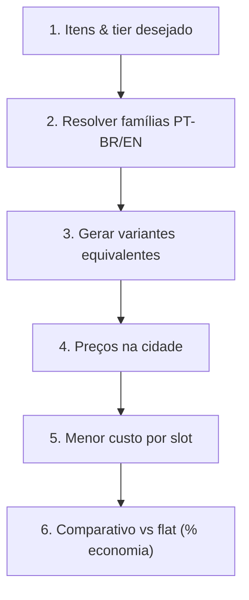

# ⚔️ Albion Online — Otimizador de Builds Econômicas

Transforma o agente em **Engenheiro de Loadouts e Otimizador de Equipamentos**.

Jogadores perdem centenas de milhares de prata comprando flat (7.0/8.0) quando combinações encantadas (5.2, 4.3, 6.1) entregam o **mesmo Item Power** por uma fração do preço.

---

## 📐 Equivalência de Tiers e Item Power

Cada nível de encantamento adiciona **+100 IP**, equivalente a um tier completo:

$$\text{Tier Equivalente} = \text{Tier Base} + \text{Encantamento}$$

| Alvo | Variantes |
| :--- | :--- |
| **T6 eq.** | `6.0`, `5.1`, `4.2` |
| **T7 eq.** | `7.0`, `6.1`, `5.2`, `4.3` |
| **T8 eq.** | `8.0`, `7.1`, `6.2`, `5.3`, `4.4` |

> [!TIP]
> Em itens populares (Casaco de Mercenário, Capuz de Assassino), `5.2`/`4.3` costuma custar **40%–65% menos** que o `7.0` flat.

---

## 🎲 Qualidade & Reroll na Bancada de Reparo

$$\mathbb{E}[\text{Custo}] = \frac{\text{Custo por Tentativa}}{q_T}$$

| Qualidade | Bônus de IP | Equivalência | Prob. acumulada | $\mathbb{E}$[tentativas] |
| :--- | :--- | :--- | :--- | :--- |
| **Bom (Q2)** | +10 | +0.1 tier | ~31,1% | ~3,2 |
| **Notável (Q3)** | +20 | +0.2 tier | ~6,1% | ~16,4 |
| **Excelente (Q4)** | +50 | +0.5 tier | ~1,1% | ~90,9 |
| **Obra-prima (Q5)** | +100 | +1.0 tier | ~0,1% | ~1.000 |

*O item nunca perde qualidade: resultado igual ou inferior preserva a qualidade atual.*

---

## 🔄 Fluxo de Otimização



---

## 🛠️ Comandos

> Execute os comandos **a partir da pasta desta skill** (a que contém este `SKILL.md`):
> `.opencode/skills/albion-build-optimizer/` no repositório ou `.agents/skills/albion-build-optimizer/` após `npx skills add`.

```bash
# Otimizar build T7 equivalente em Lymhurst
python3 scripts/optimize_loadout.py \
  --city Lymhurst --tier 7 \
  --items "Machado de Guerra" "Casaco de Mercenário" "Capuz de Caçador" "Botas de Soldado"

# Usar média histórica de 7 dias em vez do preço ao vivo
python3 scripts/optimize_loadout.py \
  --city Martlock --tier 6 --price-mode history --items "Espadão" "Peitoral de Soldado"

# Simular reroll de qualidade (Q1 -> Q4) de um item
python3 scripts/optimize_loadout.py \
  --reroll --item-id T6_MAIN_SWORD --current-quality 1 --target-quality 4

# Detalhes técnicos de um item (slot e insumos de encantamento)
python3 - <<'EOF'
import sys; sys.path.insert(0, ".")
from _albion_core import items
print(items.item_details("T6_ARMOR_LEATHER_SET1"))
EOF
```

A saída traz, por slot, todas as variantes com preço, a recomendada, a referência flat e a economia em prata/percentual.

---

## 📋 Como responder ao jogador

1. Tabela por slot: variante, preço, e a escolhida (✅).
2. Total otimizado vs total flat + economia absoluta e percentual.
3. Se alguma variante estiver sem ordem ativa, diga isso — não estime preço.
4. Se o jogador citar qualidade, rode o reroll e compare o EV com o preço de mercado da qualidade desejada.
5. Lembre que **IP igual não significa performance igual**: encantamento afeta atributos e o custo de reparo.
