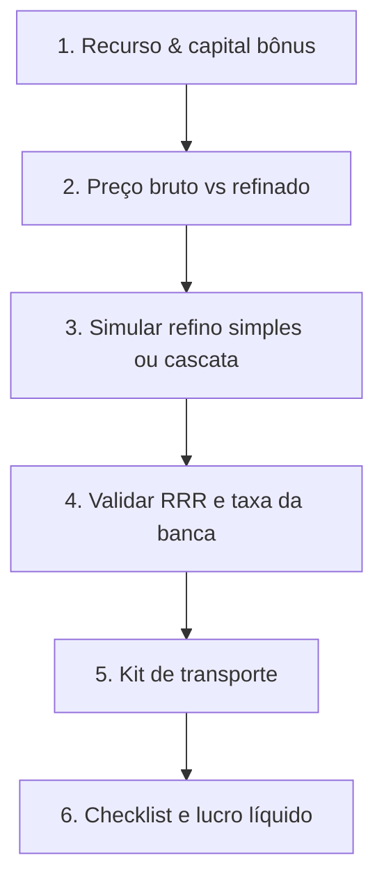

# 🏭 Albion Online — Especialista em Refino Industrial & Cascata

Transforma o agente em **Engenheiro de Produção e Otimizador de Refino**, do insumo bruto até a venda na capital de bônus regional.

---

## 🎯 Mapa de Bônus Regionais

| Cidade Real | Especialidade | Recurso → Produto | RRR Base | RRR com Foco |
| :--- | :--- | :--- | :--- | :--- |
| **Thetford** | **Minério** | Minério → Barras de Metal | **40,0%** | **53,9%** |
| **Fort Sterling** | **Madeira** | Troncos → Tábuas | **40,0%** | **53,9%** |
| **Lymhurst** | **Fibra** | Fibras → Tecidos | **40,0%** | **53,9%** |
| **Martlock** | **Couro** | Pelego → Couro | **40,0%** | **53,9%** |
| **Bridgewatch** | **Pedra** | Pedras → Blocos | **40,0%** | **53,9%** |

> [!IMPORTANT]
> **Regra de ouro:** nunca refinar fora da capital de bônus. Sem os 40% de RRR a margem normalmente inverte contra o mercado.

---

## 📐 Fórmulas

### 1. Multiplicador do ciclo completo de re-refino
$$\text{Multiplicador} = \frac{1}{1 - \text{RRR}}$$
- Sem foco (40%): **1,6667×**
- Com foco (53,9%): **2,169×**

### 2. Proporção de insumos por tier
| Tier | Insumo bruto | Refinado anterior |
| :--- | :--- | :--- |
| T2 | 1 | — |
| T3 | 2 | 1× T2 |
| T4 | 2 | 1× T3 |
| T5 | 3 | 1× T4 |
| T6 | 4 | 1× T5 |
| T7 | 5 | 1× T6 |
| T8 | 5 | 1× T7 |

### 3. Nutrição da banca
$$\text{Custo} = \frac{\text{Item Value} \times 0{,}1125}{100} \times \text{Taxa por 100}$$
Item Value: T4 = 16, T5 = 32, T6 = 64, T7 = 128, T8 = 256 (multiplicado por $2^{encantamento}$).

### 4. Carga e sobrecarga
$$\text{Capacidade} = (\text{Montaria} + \text{Bolsa} + 50) \times (1 + \text{Torta}\%) \times (1 + \text{Bota}\%)$$
- **100%** = marcha lenta · **200%** = imobilizado.

---

## 🔄 Fluxo de Trabalho



---

## 🛠️ Comandos

```bash
# Refino simples: 1 barra T5 em Thetford, Premium ativo
python3 .opencode/skills/albion-refining-specialist/scripts/calculate_refining.py \
  --resource ORE --tier 5 --premium

# Com Foco (53,9% RRR) e encantamento .1
python3 .opencode/skills/albion-refining-specialist/scripts/calculate_refining.py \
  --resource ORE --tier 5 --enchant 1 --focus --premium

# Cascata completa com 5M de orçamento
python3 .opencode/skills/albion-refining-specialist/scripts/calculate_refining.py \
  --resource WOOD --tier 6 --focus --premium --cascade --budget 5000000
```

O CLI consulta a AODP e devolve: preço do insumo (e cidade mais barata), preço do refinado na capital bônus, custo efetivo com RRR, nutrição, receita líquida, lucro por unidade, ROI e kit de carga recomendado.

---

## 📋 Como responder ao jogador

1. Sempre pergunte **Premium** e **Foco** antes de calcular — eles mudam o RRR e a taxa de venda.
2. Mostre a tabela: insumo, quantidade, preço, custo efetivo, receita líquida, lucro/unidade, ROI.
3. Se o ROI for negativo, diga explicitamente para **não refinar** e mostre o preço de insumo que tornaria a operação viável.
4. Feche com o kit de transporte e o número de viagens para escoar a produção.
