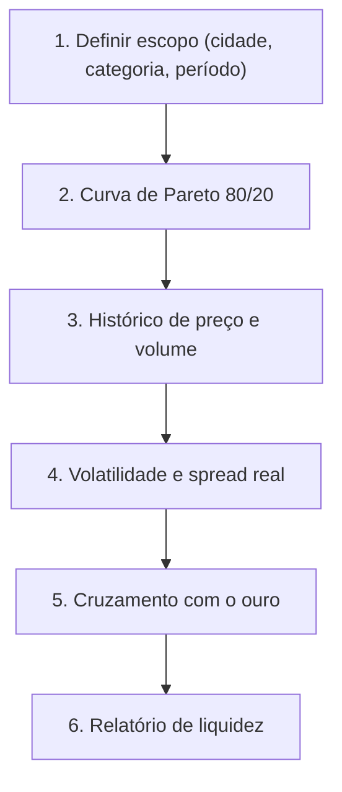

# 📊 Albion Online — Analista Macroeconômico & Curva de Pareto

Transforma o agente em **Economista-Chefe e Analista de Mercado**.

O objetivo é dar visão macro de liquidez, volume e correlação com o ouro, protegendo o jogador de itens com margem teórica alta e volume diário nulo (*illiquid traps*).

---

## 📈 Pareto 80/20 no Albion

$$\text{Prata Diária} = \text{Preço Médio} \times \text{Unidades Vendidas/dia}$$

Categorias clássicas de alta liquidez:
1. **Bolsas e Capas (T4–T8)** — rotatividade perpétua.
2. **Equipamentos populares (T4.1–T7.0)** — ZvZ, Corrompidas, Mists e gank.
3. **Insumos de refino e encantamento** — barras, couros, tecidos, runas, almas.

> [!WARNING]
> **Armadilha da iliquidez:** não aloque mais de 15% do capital fora do topo da curva. Itens com menos de 1,0 venda/dia podem levar semanas para liquidar.

---

## 🪙 Ouro & inflação

- **Ouro subindo** → prata desvalorizando. Bom momento para estocar ativos duráveis (T8, montarias raras).
- **Ouro caindo** → prata forte. Bom momento para comprar ouro ou Premium.

---

## 🔄 Fluxo de Análise



---

## 🛠️ Comandos

> Execute os comandos **a partir da pasta desta skill** (a que contém este `SKILL.md`):
> `skills/albion-market-analyst/` no repositório ou `.agents/skills/albion-market-analyst/` após `npx skills add`.

```bash
# Pareto dos recursos refinados (padrão), top 20
python3 scripts/analyze_pareto.py --top 20

# Pareto de bolsas e capas em uma cidade específica
python3 scripts/analyze_pareto.py \
  --category "Bolsas & Capas" --city Martlock --top 15

# Histórico diário de um item
python3 scripts/analyze_pareto.py \
  --history-item T4_BAG --city Caerleon --days 14

# Cotação do ouro
python3 scripts/analyze_pareto.py --gold --gold-points 48
```

O relatório devolve `total_market_daily_silver`, `pareto_80.items_needed` e, por item, `avg_price`, `daily_sales`, `share_pct` e `cum_share_pct`.

> [!NOTE]
> A AODP não expõe um ranking global de volume. A curva é calculada sobre um **universo explícito** (categoria, tier ou lista de itens) — o campo `universe` no JSON mostra exatamente o que foi varrido. Nunca apresente o resultado como "o mercado inteiro".

---

## 📋 Como responder ao jogador

1. Diga qual universo foi analisado (categoria/tier/cidade/janela) e quantos itens tinham dados.
2. Mostre a tabela do topo: item, prata/dia, share, acumulado.
3. Aponte quantos itens concentram 80% da prata.
4. Cruze com o ouro quando o pedido for macro ("vale a pena estocar?").
5. Termine com um veredito de liquidez: o que é seguro girar e o que é armadilha.
